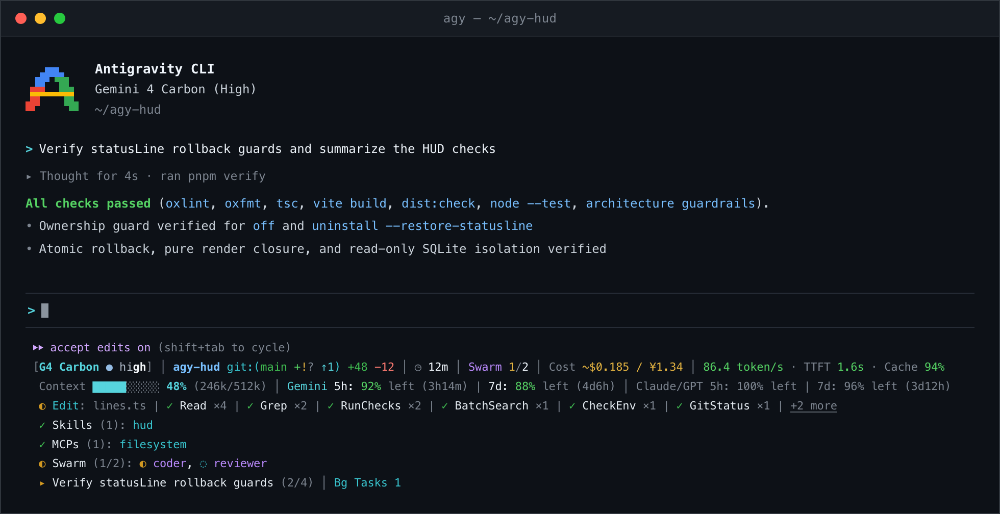

<div align="center">


# agy-hud

**A live terminal HUD below your Antigravity CLI prompt — with snapshots & profile portability.**<br>
Model, readable quotas, throughput, enhanced Git diff stats, USD/CNY cost, active tools, and `/swarm` status — zero build, zero runtime dependencies.

[](https://github.com/ifelseboyxx/agy-hud/actions/workflows/ci.yml)
[](LICENSE)


[](https://github.com/ifelseboyxx/agy-hud/stargazers)

[Install](#install) · [What you see](#what-you-see) · [Overflow inspector](#overflow-inspector) · [Configure](#configure) · [Uninstall](#uninstall) · [简体中文](README.zh-CN.md)


<br>
<sub>Live <code>full</code> preset below the Antigravity CLI prompt: model, throughput, context, quotas, tools, skills, MCPs, <code>/swarm</code>, and todos</sub>

</div>

## Why

While Antigravity runs a turn, you want to see which model and thinking effort are active, how much context and rate-limit quota remain, whether streaming throughput has stalled, how much the session costs, and what tools or `/swarm` workers are doing — without interrupting the session or tailing logs.

`agy-hud` stays pinned below your Antigravity CLI prompt with live, width-aware telemetry, clickable OSC 8 snapshots, and terminal popup inspection — with zero runtime dependencies and zero local build steps.

## What you see

The default (`full`) layout renders active mode, identity and performance metrics, context and quota bars, and live activity rows whenever tools, skills, MCP servers, swarms, or todos are active:

```text
 ⏵⏵ accept edits on (shift+tab to cycle)
 [G4 Carbon ● high] │ agy-hud git:(main +!? ↑1) +48 -12 │ ◷ 12m │ Swarm 1/2 │ Cost ~$0.185 / ¥1.34 │ 86.4 token/s · TTFT 1.6s · Cache 94%
  Context █████░░░░░ 48% (246k/512k) │ Gemini 5h: 92% left (3h14m) | 7d: 88% left (4d6h)
  ◐ Edit: lines.ts | ✓ Read ×4 | ✓ Grep ×2 | +3 more
  ✓ Skills (1): hud
  ✓ MCPs (1): filesystem
  ◐ Swarm (1/2): ◐ coder, ◌ reviewer
  ▸ Verify statusLine rollback guards (2/4) │ Bg Tasks 1
```

- **Mode (`mode`)** — active permission or agent mode (`bypass permissions`, `accept edits`, `plan`, `auto`, `default`), optional Vim tag (`[NORMAL]` / `[INSERT]`), and cycle hint
- **Identity & Perf (`identity`)** — model and model-aware thinking effort (`◔ low` / `◑ medium` / `◕ high` / `● peak` / `✦ max`, automatically promoting each model's highest supported tier such as `xhigh` on Hydrogen/Neon and `high` on Carbon/Argon/Claude/Flash to a monochrome platinum active-turn sheen, plus `Orchestrator (Planner/Executor)`), workspace and cached enhanced Git status (`=+!->?$ ↑N↓N` + `+N -M` tracked diff lines, degrading to `git:(branch*)` below 100 cols), duration, `Swarm` / `Agents` counter, runtime badges (`@agent`, `Battle`, `Bg Tasks`, `! Approval`, `! Auth`, `Review`, `Retry`, `! Error`, `Queued`), offline USD/CNY session cost (shown when the host reports a valid `cost` total in `statusLine` stdin, prefixed with `~` when estimated; auto-hidden when omitted, e.g. on quota subscriptions or models without reported pricing), and width-adaptive Perf Capsule (`token/s`, `TTFT`, `Cache%` with anomaly alerts)
- **Context & Quota (`usage`)** — color-coded Context Budget bar (`used/budget`) with CJK-aware compaction estimates (`~used/max`), alongside human-readable `Gemini` / `Claude/GPT` remaining quotas (`left`, integer percentages with `<1%`/`99%`/`100%` edge accuracy, compact `4d6h` resets, and conditional Quota Pace depletion forecast `~0% <eta>` / `!`)
- **Activity (`tools`, `skills`, `mcps`, `agents`, `todos`, or `activity`)** — running and completed tools, loaded skills and MCP servers, `/swarm` and subagent chips (`◐` working, `◌` waiting), and todo progress; width-packed with clickable OSC 8 `+N more` (or `· snapshot`) links

### Presets

| Preset | Default Lines | Inline Segments | Best For |
| :--- | :--- | :--- | :--- |
| `full` *(default)* | `mode`, `identity`, `usage`, `tools`, `skills`, `mcps`, `agents`, `todos` | All enabled | Complete live diagnostics |
| `compact` | `mode`, `identity`, `usage`, `activity` | All enabled | Daily coding with single-line Activity Summary |
| `swarm` | `mode`, `identity`, `usage`, `agents`, `todos` | All enabled | Multi-agent orchestration focus |
| `minimal` | `identity`, `usage` | `model`, `git`, `badges`, `context`, `quota` | Clean two-row bars without activity noise |
| `zen` | `identity` (folds `Ctx%` & `5h%` inline) | `model`, `git`, `badges`, `context`, `quota` | Strict single-row narrow terminals & split panes |

## Install

Requires **Node.js `^22.20.0 || >=24.0.0`** on macOS, Linux, or Windows. Zero build step required.

```bash
# Install (or re-run anytime to upgrade in place)
agy plugin install https://github.com/ifelseboyxx/agy-hud

# Or pin a specific release tag (single-segment semver tag only; never pass .zip archives)
agy plugin install https://github.com/ifelseboyxx/agy-hud/tree/v0.1.1
```

Start `agy` and activate the terminal status line in one step (hot-reloads immediately, no restart needed):

```text
/hud setup
```

Or run the built-in statusline command directly:

```text
/statusline node ~/.gemini/config/plugins/agy-hud/dist/hud.mjs
```

Pause or resume anytime inside Antigravity CLI with `/statusline`, `/statusline off`, or `/statusline on`.

> **Note:** Disabling `agy-hud` in Antigravity's plugin manager (`[disabled]` or `agy plugin disable agy-hud`) only updates `~/.gemini/config/config.json` and unloads the `/hud` skill. Because Antigravity does not manage `statusLine` as a plugin component, the terminal HUD keeps running from `~/.gemini/antigravity-cli/settings.json`. Use `/statusline off` to hide only the status line; or run `node ~/.gemini/config/plugins/agy-hud/scripts/install.mjs off` (disables only an owned `statusLine`) / `on` (rewires and enables this install, backing up any foreign `statusLine` first). On default global installs without `--no-enable` and with `agy` on `PATH`, `off` / `on` also run `agy plugin disable|enable agy-hud` best-effort (printing a fallback `Note:` without blocking exit `0` if the host plugin command fails; see [docs/host-contracts.md](docs/host-contracts.md)).

<details>
<summary><strong>Optional terminal command (<code>agy-hud</code>), diagnostics, source build &amp; Link Install migration</strong></summary>

```bash
# Optional: wire settings.json automatically and install the standalone `agy-hud` command (`!agy-hud`, `agy-hud -p`, `agy-hud preview`)
node ~/.gemini/config/plugins/agy-hud/scripts/install.mjs wire

# Wire settings.json only without installing the global `agy-hud` command
node ~/.gemini/config/plugins/agy-hud/scripts/install.mjs wire --no-shim

# Install `agy-hud` into a custom bin directory (or set AGY_HUD_BIN_DIR)
node ~/.gemini/config/plugins/agy-hud/scripts/install.mjs wire --bin-dir ~/.bin

# Disable owned statusLine / rewire & enable statusLine (+ best-effort default global plugin toggle when agy is available)
node ~/.gemini/config/plugins/agy-hud/scripts/install.mjs off
node ~/.gemini/config/plugins/agy-hud/scripts/install.mjs on

# Run full health diagnostics
node ~/.gemini/config/plugins/agy-hud/scripts/install.mjs doctor

# Switching from a legacy --link (Link Install) symlink to zero-build Plugin Install:
agy plugin uninstall agy-hud && agy plugin install https://github.com/ifelseboyxx/agy-hud

# Contributor source checkout & Link Install (requires pnpm@11.1.1)
git clone https://github.com/ifelseboyxx/agy-hud.git agy-hud && cd agy-hud
pnpm install && pnpm build
pnpm hud:wire     # symlink plugin + wire statusLine + install command + run doctor
pnpm hud:install  # symlink plugin + install command + run doctor (preserves existing statusLine)

# Project-local or custom target installs
node scripts/install.mjs install --project [dir]
node scripts/install.mjs install --target <dir> --no-enable
```

</details>

## Overflow inspector

When session activity exceeds one status line (`+N more` or `· snapshot`), inspect the full untruncated Activity Snapshot through two terminal-native channels:

- **Clickable OSC 8 links** — `Cmd+Click` (or terminal hyperlink open) any `+N more` badge or `· snapshot` tail to open the session's local `0o600` Markdown snapshot (written lazily only when a link is emitted and content changes).
- **Terminal CLI & interactive popup** — inspect the active session directly from the Antigravity CLI prompt (`!agy-hud`) or any terminal, open a single-key-dismiss overlay, or generate popup keybindings.

```bash
# Inspect active session or filter specific sections (context, tools, skills, mcps, agents)
agy-hud
agy-hud snapshot context tools agents

# Open interactive popup overlay (q/Esc/Enter close, 1-5/c/a filter, j/k scroll, r reload)
agy-hud -p

# List active and recent CLI sessions or emit structured JSON
agy-hud --sessions
agy-hud -s <id-or-prefix> --json

# Print ready-to-paste popup shortcut snippets (tmux, kitty, wezterm, ghostty, iterm2, or all)
agy-hud --keybindings
agy-hud --keybindings all
```

## Configure

Use **`/hud`** inside Antigravity in natural language (for example, `/hud compact`, `/hud preview`, `/hud setup`, or `/hud check`), or run `agy-hud` from your terminal (without the optional `agy-hud` command on `PATH`, substitute `node ~/.gemini/config/plugins/agy-hud/dist/cli.mjs`):

```bash
# Preview HUD layouts offline at any width without starting a live session
agy-hud preview 120
agy-hud preview --narrow
agy-hud preview --all-presets

# Launch interactive two-tier TUI editor (presets + live preview, then modules, osc8Links & costCurrency)
agy-hud configure -i

# Inspect effective configuration
agy-hud configure --show

# Switch preset (full | compact | swarm | minimal | zen)
agy-hud configure compact

# Enable, disable, or reorder Line Modules and Inline Segments in one command
agy-hud configure compact --enable tools,agents --disable activity,cost --order identity,usage,tools,agents

# Configure USD / CNY session cost display (100% offline, zero network calls)
agy-hud configure --set costCurrency=both --set usdToCnyRate=7.25

# Configure narrow split-pane overrides (triggered automatically when terminal_width < 100)
agy-hud configure --narrow-disable cost,perf,todos
agy-hud configure --set narrow.segments.cost=inherit
agy-hud configure --narrow-reset

# Reset to full defaults
agy-hud configure --reset
```

Settings live in `~/.gemini/antigravity-cli/hud-config.json` (respects `GEMINI_CLI_HOME`). Inside a source checkout, you can also run `pnpm hud:configure -- <flags>`.

<details>
<summary><strong>All configuration options</strong></summary>

| Key | Type / Values | Default | Description |
| :--- | :--- | :---: | :--- |
| `preset` | `full` \| `compact` \| `swarm` \| `minimal` \| `zen` | `full` | Base persona preset used to seed `lines` and `segments`. |
| `lines` | Ordered array of `mode`, `identity`, `usage`, `activity`, `tools`, `skills`, `mcps`, `agents`, `todos` | `full` lines | Explicit pluggable rows rendered in order; empty rows auto-collapse. |
| `segments` | Booleans for `model`, `git`, `duration`, `badges`, `cost`, `perf`, `context`, `quota` | All `true` | Toggleable inline segments within `identity` and `usage` (and `zen` folded tail). |
| `costCurrency` | `usd` \| `cny` \| `both` | `usd` | Offline cost currency format (`both` renders `$0.818 / ¥5.93`, compacting to `$0.82/¥5.93` below 100 cols); shown when the host reports a valid `cost` total in `statusLine` stdin (`agy-hud` does not maintain a local pricing table). |
| `usdToCnyRate` | number `0.01..1000` | `7.25` | Offline USD-to-CNY conversion rate shared across HUD, OSC 8 Markdown, and CLI `snapshot`. |
| `narrow` | `{ lines?: HudLineId[], segments?: Partial<HudSegments> }` | *(omitted)* | Optional split-pane overrides active when `terminal_width < 100`; omitted keys inherit top-level config and skipped modules skip collectors. |
| `osc8Links` | `boolean` | `true` | Emit OSC 8 hyperlinks on `+N more` / `snapshot` (suppressed under `NO_COLOR`, `TERM=dumb`, or SSH). |
| `maxAgentChips` | integer `0..20` | `8` | Maximum Swarm/Agent chips shown before `+N more` (`0` hides the row). |

</details>

## Profile migration

Move your Antigravity CLI preferences, HUD settings (including `costCurrency`, `usdToCnyRate`, and `narrow` overrides), MCP server templates, and plugin inventory across machines without leaking credentials:

```bash
# Export sanitized templates and plugins-manifest.json
agy-hud export-profile --out ./agy-profile

# Import on another machine (add --merge-mcp to merge missing MCP servers)
agy-hud import-profile --in ./agy-profile --merge-mcp
```

- **Exported bundle** — `settings.template.json`, `config.template.json`, `mcp_config.template.json`, `hud-config.json`, and `plugins-manifest.json`
- **Automatic sanitization** — applies key whitelists, drops machine-local bindings (`trustedWorkspaces`, `remoteControlHostname`, `sidecars.*.projectId`), and replaces tokens, secrets, sensitive CLI flags/headers, and URL credentials with `<SET_IN_ENV>`; review exported files manually before sharing publicly
- **Safe import** — validates all JSON inputs before writing, deep-merges `settings.json` while preserving the target machine's `trustedWorkspaces`, leaves `~/.gemini/config/config.json` untouched (printing manual steps instead), and skips existing `mcp_config.json` unless `--merge-mcp` is passed

## Uninstall

Always detach the CLI status line **before** removing the plugin so Antigravity CLI's 30-failure statusline circuit breaker is never triggered. You can also run **`/hud uninstall`** (or `/hud uninstall --purge`) inside Antigravity CLI.

### Recommended 2-Step Clean Uninstall

```bash
# 1. Restore previous statusLine, remove owned `agy-hud` command, and sweep transient caches (keeps hud-config.json)
node ~/.gemini/config/plugins/agy-hud/scripts/install.mjs unwire

# 2. Remove the plugin package and its registry entries
agy plugin uninstall agy-hud
```

For **zero-residue purge** (also removes `hud-config.json` and orphaned statusLine backups, printing a cleaned-files receipt):

```bash
node ~/.gemini/config/plugins/agy-hud/scripts/install.mjs unwire --purge
agy plugin uninstall agy-hud
```

Inside a live CLI session, run `/statusline delete` to immediately clear the active bar without restarting.

### File footprint

| Location | Default (`unwire` + `agy plugin uninstall`) | Zero-residue (`unwire --purge` + `agy plugin uninstall`) |
| :--- | :---: | :---: |
| `~/.gemini/config/plugins/agy-hud/` & `config.json` / `import_manifest.json` | Removed | Removed |
| Owned `statusLine` entry in `~/.gemini/antigravity-cli/settings.json` | Restored / Removed | Restored / Removed |
| Owned `agy-hud` command (`~/.local/bin/agy-hud` or `%LOCALAPPDATA%\agy\bin\agy-hud*`) | Removed | Removed |
| Transient caches (`~/.gemini/antigravity-cli/cache/agy_hud_*`) | Removed | Removed |
| `~/.gemini/antigravity-cli/hud-config.json` | Preserved | Removed |
| Orphaned `~/.gemini/antigravity-cli/cache/agy-hud-statusline-backup.json` | Removed if restored | Removed (unless another live `agy-hud` owns `settings.json`) |

<details>
<summary><strong>Recovery after out-of-order uninstall &amp; source / Link Install uninstall</strong></summary>

- **Ran `agy plugin uninstall agy-hud` before `unwire`**: run `/statusline delete` inside Antigravity CLI (or remove `statusLine` from `~/.gemini/antigravity-cli/settings.json`). If a leftover `agy-hud` shim remains on `PATH`, invoking it prints the exact `rm` / `del` path to `stderr` without deleting files automatically.
- **Source / `Link Install` / project-local uninstall**: inside your local checkout, run `node scripts/install.mjs uninstall --restore-statusline` (add `--purge` for zero-residue cleanup).

</details>

## How it works

`agy-hud` combines Antigravity CLI `statusLine` stdin payloads with strictly read-only local telemetry, transcripts, SQLite/WAL databases, `/swarm` rosters, and cached non-locking Git status. One shared incremental scanner and aggregator powers all three CLI surfaces so counts and ordering stay identical everywhere.

```text
 Antigravity CLI (stdin ~300 ms) ──┐
 Local SQLite/WAL + transcripts  ──┼──> Shared collectors & aggregator ──> Terminal HUD / OSC 8 / CLI Snapshot
 /swarm roster + Git + proc      ──┘                                   (strictly read-only on CLI DB dirs)
```

| Surface | Reads from | Delivered via |
| :--- | :--- | :--- |
| **Terminal HUD** (`dist/hud.mjs`) | `statusLine` stdin, `hud-config.json`, transcripts, SQLite/WAL, `/swarm`, cached Git | ANSI lines pinned below the CLI prompt |
| **OSC 8 Snapshot** | Same live collector pass (digest-gated) | Lazy `0o600` Markdown file in `<cliHome>/cache/` |
| **CLI & Popup** (`agy-hud` / `-p`) | CLI session index, transcripts, and SQLite/WAL DBs | Structured terminal output, `-p` overlay, or JSON |

More detail is in [docs/architecture.md](docs/architecture.md) and [docs/host-contracts.md](docs/host-contracts.md).

## Security and reliability

- **Local-only, zero network calls** — reads only `statusLine` stdin JSON, local CLI session files, local Git metadata (`--no-optional-locks`), and (during profile commands) `~/.gemini/config`; USD/CNY conversion is 100% offline
- **Zero runtime dependencies** — compiled into 5 standalone unhashed ESM/type files (`dist/hud.mjs`, `dist/cli.mjs`, `dist/index.mjs`, `dist/index.d.mts`, `dist/types.d.mts`) using only Node built-ins (`node:sqlite`, `node:fs`, `node:child_process`) and a pure-TypeScript Protobuf decoder
- **Read-only DB access & path containment** — CLI SQLite and WAL files are read strictly read-only (`?immutable=1` or short-lived `os.tmpdir()` snapshot copies, 50 ms timeout, zero writes to database directories); caches stay in `<cliHome>/cache` (`0o600`), and session/transcript/skill paths are validated against trusted roots
- **Ownership-gated writes & atomic rollback** — `settings.json` goes through a single locked writer (`src/cli/installer/settings.ts`); command shims carry `agy-hud-shim:v1` headers and pass a 5 s `--help` smoke check without touching shell rc files or the Windows Registry; corrupt user JSON fails closed without being overwritten, and failed `install`/`wire` transactions roll back atomically

## Development

```bash
pnpm install
pnpm dev             # preview README and docs locally in your browser
pnpm dist:check      # verify tracked dist/ matches src/ byte-for-byte with 100755 modes
pnpm verify          # lint, format check, typecheck, build, tests, and guardrails
pnpm validate:plugin # run official agy plugin validate --json check (requires agy CLI)
```

`pnpm verify` runs `oxlint --type-aware --deny-warnings`, `oxfmt --check`, `tsc --noEmit`, `pnpm build` (Vite 8 + Rolldown), isolated `node --test` suites, and repository architecture + Marketplace manifest guardrails.

To test against an isolated home directory without touching your live Antigravity setup, set `GEMINI_CLI_HOME=<tmp>` and `GEMINI_HOME=<tmp>/.gemini` together with `--target <tmp-plugin-dir>`.

## License

[MIT](LICENSE).

## Star History

<a href="https://star-history.com/#ifelseboyxx/agy-hud&Date">
  <picture>
    <source media="(prefers-color-scheme: dark)" srcset="https://api.star-history.com/svg?repos=ifelseboyxx/agy-hud&type=Date&theme=dark" />
    <source media="(prefers-color-scheme: light)" srcset="https://api.star-history.com/svg?repos=ifelseboyxx/agy-hud&type=Date&theme=light" />
    
  </picture>
</a>
