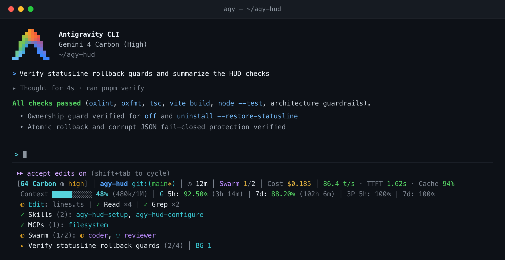

# agy-hud

面向 Antigravity CLI 的实时终端 HUD 状态栏与配置迁移插件：常驻输入框下方，实时展示模型与思考强度、上下文进度条、配额余量、吞吐/首字延迟/缓存命中率、活跃工具、原生 `/swarm` 状态与待办进度，并支持跨机脱敏配置迁移。

[](LICENSE)
[](https://github.com/ifelseboyxx/agy-hud/stargazers)




> [English](README.md) | **简体中文**

## 显示效果

默认（`full`）预设会展示当前权限/模式、模型与性能指标、上下文与配额状态，并在工具、Skills、MCP、Swarm 或待办活跃时自动追加活动行：

```text
 ⏵⏵ accept edits on (shift+tab to cycle)
 [G4 Carbon ◑ high] │ agy-hud git:(main*) │ ◷ 12m │ Swarm 1/2 │ Cost $0.185 │ 86.4 t/s · TTFT 1.62s · Cache 94%
  Context █████░░░░░ 48% (480k/1M) │ G 5h: 92.50% (3h 14m) | 7d: 88.20% (102h 6m)
  ◐ Edit: lines.ts | ✓ Read ×4 | ✓ Grep ×2
  ✓ Skills (2): agy-hud-setup, agy-hud-configure
  ✓ MCPs (1): filesystem
  ◐ Swarm (1/2): ◐ coder, ◌ reviewer
  ▸ Verify statusLine rollback guards (2/4) │ BG 1
```

- **模式行（Mode Line）**：展示当前权限或代理模式（`bypass permissions`、`accept edits`、`plan`、`auto` 或 `default`）、可选 Vim 模式标记（`[NORMAL]` / `[INSERT]`）及快捷键提示。
- **第 1 行（身份与性能）**：模型与思考强度（支持 `Orchestrator (Planner/Executor)` 角色解析）、当前目录与 git 分支（脏工作区带 `*`）、会话耗时、活跃 `Swarm` / `Agents` 计数、运行时徽章（`@agent`、`Battle`、`BG`、`! Approval`、`Q:N`）、会话费用，以及自适应终端宽度的 **Perf Capsule**（`t/s`、`TTFT`、`Cache%`，窄屏自动逐段裁剪）。
- **第 2 行（上下文与配额）**：随占用自动变色的上下文进度条（<50% 青色、>=50% 黄色、>=80% 红色），终端宽度 `>= 95` 列时附带 token 容量并在上下文压缩后自动切换为估算值（`~used/max`）；同时根据当前模型优先展示 `G` 或 `3P` 配额余量及重置倒计时，终端宽度 `>= 120` 列且空间允许时附带次级配额桶。
- **活动行（Activity Lines）**：展示运行中与已完成的工具汇总、已加载的 Skills 与 MCP 服务、原生 `/swarm` 成员状态芯片（`◐` 工作中、`◌` 等待中，与 stdin `subagents` 合并去重）以及待办进度。超出单行上限时自动折叠为 `+N more`。

### 展示预设

| 预设 | 模式行 | 第 1、2 行 | Swarm / Agents 芯片 | 工具、Skills/MCP 与待办 |
| :--- | :---: | :---: | :---: | :---: |
| `full` *(默认)* | 开启 | 开启 | 开启 | 开启 |
| `compact` | 开启 | 开启 | 开启 | 关闭 |
| `minimal` | 关闭 | 开启 | 关闭 | 关闭 |

<!-- 可选预设对比图：保存至 assets/presets.png 后取消下方注释：

-->

## 安装

运行前需要 **Antigravity CLI（`agy`）**、**Node.js `^22.20.0 || >=24.0.0`**，从源码构建需要 **`pnpm@11.1.1`**。

```bash
git clone https://github.com/ifelseboyxx/agy-hud.git agy-hud
cd agy-hud
pnpm install && pnpm build
node scripts/install.mjs install --wire-statusline
```

该命令会将构建产物复制到 `~/.gemini/config/plugins/agy-hud`，自动备份 `~/.gemini/antigravity-cli/settings.json` 中原有的 `statusLine` 配置并接入 `dist/hud.mjs`，随后执行 `doctor` 健康检查并通过 `agy plugin enable agy-hud` 启用插件。若中途失败，已暂存的文件与配置会自动回滚。

<details>
<summary><strong>开发链接安装、自定义目录、诊断与卸载恢复</strong></summary>

```bash
# 开发模式：以符号链接安装到 ~/.gemini/config/plugins/agy-hud 并接入 statusLine
pnpm hud:wire

# 仅符号链接插件，不改动现有 statusLine
pnpm hud:install

# 安装到项目 .agents/plugins/agy-hud 或自定义目录
node scripts/install.mjs install --project [dir]
node scripts/install.mjs install --target <dir> --no-enable

# 运行完整健康检查（Node 版本、node:sqlite、stdin 渲染冒烟、settings、agy plugin validate）
pnpm hud:doctor

# 卸载插件并按备份恢复原有 statusLine（仅在当前 statusLine 归属本次安装时修改）
node scripts/install.mjs uninstall --restore-statusline
```

</details>

### 启停控制

- **Antigravity CLI 会话内**：`/statusline`（快速切换）、`/statusline off` / `/statusline on`、`/statusline delete`（清除自定义配置并回退为内置默认状态栏）。
- **终端命令**：`pnpm hud:off` / `pnpm hud:on`（或 `node scripts/install.mjs off|on`），联动更新 `statusLine.enabled` 与 `agy plugin disable|enable agy-hud`。
- **仅开关插件包**：`agy plugin disable agy-hud` / `agy plugin enable agy-hud`。

## 配置与自定义

插件内置了 `agy-hud-setup` 与 `agy-hud-configure` 两个 Skill，你可以直接在 Antigravity CLI 对话中用自然语言下达指令，例如：“把 agy-hud 切换为 compact 预设”、“隐藏费用并把 swarm 芯片上限调到 6”、“运行 agy-hud 健康检查”。

也可以在终端中直接配置：

```bash
# 查看当前生效配置
node dist/cli.mjs configure --show

# 切换预设（full | compact | minimal）
node dist/cli.mjs configure --preset compact

# 单独调整开关或上限
node dist/cli.mjs configure --set showPerfCapsule=true --set showCost=false --set maxAgentChips=6

# 重置为默认配置
node dist/cli.mjs configure --reset
```

配置文件位于 `~/.gemini/antigravity-cli/hud-config.json`（支持 `GEMINI_CLI_HOME` 覆盖）。在源码仓库根目录也可使用 `pnpm hud:configure -- <参数>`。

<details>
<summary><strong>全部配置项一览</strong></summary>

| 配置键 | 类型 / 取值 | 默认值 | 说明 |
| :--- | :--- | :---: | :--- |
| `preset` | `full` \| `compact` \| `minimal` | `full` | 整体展示密度预设（渲染时按预设收敛次级行开关）。 |
| `showModeLine` | `boolean` | `true` | 是否在第 1 行上方显示权限/代理模式行。 |
| `showPerfCapsule` | `boolean` | `true` | 宽度允许时是否在第 1 行右侧展示 `t/s`、`TTFT`、`Cache%`。 |
| `showQuota` | `boolean` | `true` | 是否在第 2 行展示 `5h` / `7d` 配额余量与重置倒计时。 |
| `showCost` | `boolean` | `true` | 当 CLI stdin 提供费用字段时是否在第 1 行展示会话 USD 费用。 |
| `showSwarmChips` | `boolean` | `true` | 是否展示 Swarm / Subagents 成员活动行。 |
| `showToolsLine` | `boolean` | `true` | 是否展示运行中与已完成的工具汇总行。 |
| `showSkillsMcpLine` | `boolean` | `true` | 是否展示已加载的 Skills 与 MCP 服务行。 |
| `showTodosLine` | `boolean` | `true` | 是否展示待办进度与后台任务数行。 |
| `maxAgentChips` | 整数 `0..20` | `4` | Swarm/Agent 芯片单行最大显示数量（超出折叠为 `+N more`，`0` 为隐藏）。 |

</details>

## 跨机配置迁移

在多台机器间迁移 Antigravity CLI 偏好设置、HUD 配置、MCP 模板与插件清单，同时自动剥离本地敏感信息：

```bash
# 导出脱敏配置模板与 plugins-manifest.json
node dist/cli.mjs export-profile --out ./agy-profile

# 在目标机器导入（追加 --merge-mcp 可仅补充缺失的 MCP 服务）
node dist/cli.mjs import-profile --in ./agy-profile --merge-mcp
```

- **导出产物**：`settings.template.json`、`config.template.json`、`mcp_config.template.json`、`hud-config.json` 与 `plugins-manifest.json`。
- **自动脱敏规则**：按白名单筛选可迁移字段，剔除机器绑定项（`trustedWorkspaces`、`remoteControlHostname`、`sidecars.*.projectId`），并将密钥/令牌、敏感命令行参数与请求头、URL 鉴权信息统一替换为 `<SET_IN_ENV>`。公开发布或分享前仍建议人工复核。
- **无损导入保护**：写入前先全量校验输入 JSON；深度合并 `settings.json` 时保留目标机原有的 `trustedWorkspaces`；绝不自动修改 `~/.gemini/config/config.json`（仅输出人工参考提示）；目标机已存在 `mcp_config.json` 时默认跳过，传入 `--merge-mcp` 才增量补充缺失项。

## 安全与可靠性

- **零运行时依赖**：构建为独立 ESM 产物（`dist/hud.mjs`、`dist/cli.mjs`），仅使用 Node.js 内置模块（`node:sqlite`、`node:fs`、`node:child_process`）与纯 TypeScript Protobuf 解码器。
- **只读遥测与路径隔离**：会话 SQLite 数据库以只读模式打开（`?mode=ro` / `?immutable=1`，50ms 超时）并配合本地 `mtime`/大小缓存增量读取；`conversation_id`、`transcript_path` 与 Skill 路径均经可信根目录校验，阻断路径穿越与符号链接逃逸。
- **归属校验与原子回滚**：`settings.json` 由单一带锁写入模块（`src/cli/installer/settings.ts`）管理；`off` 与 `uninstall --restore-statusline` 严格校验规范路径归属，避免误伤其他状态栏配置；损坏的 JSON 报错并原样保留而非覆盖为空对象，安装失败自动回滚。
- **纯本地数据边界**：仅读取 statusLine stdin JSON、`~/.gemini/antigravity-cli` 本地会话数据、当前目录 `.git/HEAD` 及（迁移命令中的）`~/.gemini/config`，不发起任何网络请求。

## 运行环境要求

- Antigravity CLI（`agy`）
- Node.js `^22.20.0 || >=24.0.0`（需内置 `node:sqlite`）
- `pnpm@11.1.1`（从源码构建与开发）

## 开发与验证

```bash
pnpm install
pnpm verify
```

`pnpm verify` 依次执行 `oxlint --type-aware --deny-warnings`、`oxfmt --check`、`tsc --noEmit`、`vite build`（Vite 8 + Rolldown）、隔离环境的 `node --test` 以及全仓工程守卫校验。

如需在不触碰日常 Antigravity 环境的前提下隔离演练，可通过 `GEMINI_CLI_HOME=<临时目录>`、`GEMINI_HOME=<临时目录>/.gemini` 与 `--target <临时插件目录>` 指定沙箱路径。

## 许可证

MIT，参见 [LICENSE](LICENSE)。

## Star 历史

<a href="https://star-history.com/#ifelseboyxx/agy-hud&Date">
  <picture>
    <source media="(prefers-color-scheme: dark)" srcset="https://api.star-history.com/svg?repos=ifelseboyxx/agy-hud&type=Date&theme=dark" />
    <source media="(prefers-color-scheme: light)" srcset="https://api.star-history.com/svg?repos=ifelseboyxx/agy-hud&type=Date" />
    
  </picture>
</a>
